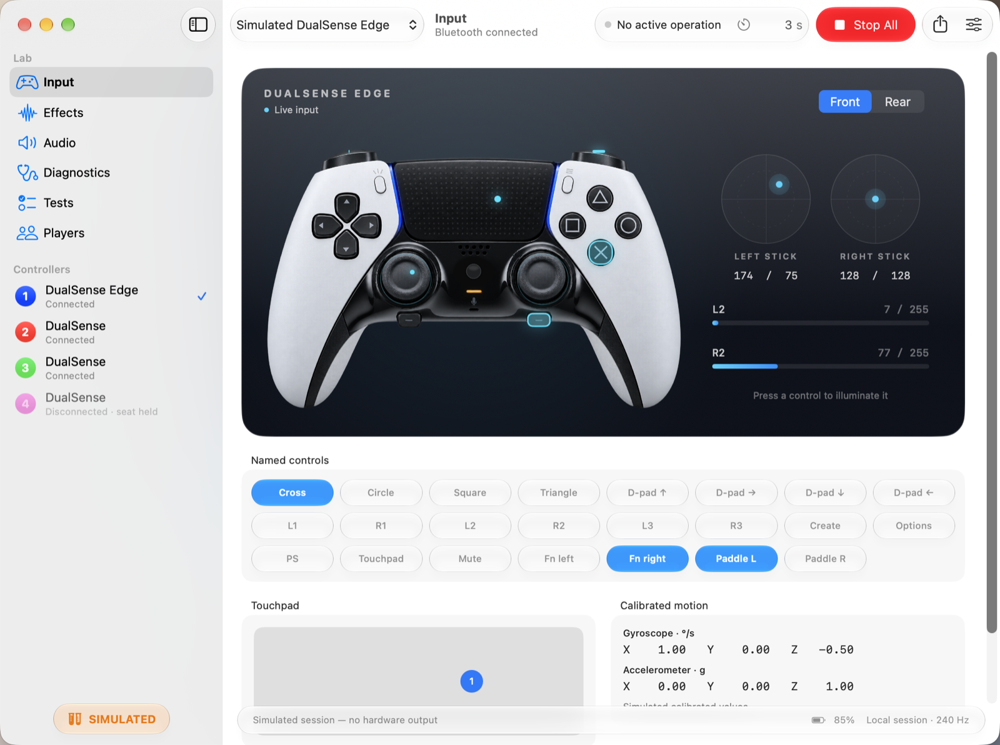
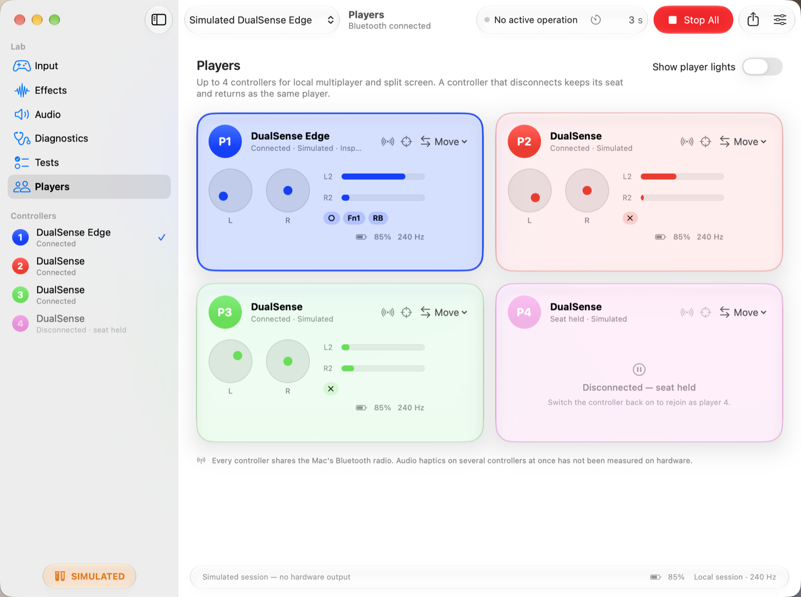

# Tactile Lab

Explore a PlayStation 5 **DualSense** or **DualSense Edge** controller on your Mac over Bluetooth. Not affiliated with Sony.

- **Input:** live buttons, sticks, triggers, touchpad and calibrated motion on a controller diagram, plus battery and report rate.
- **Effects:** lightbar and player LEDs, rumble, adaptive-trigger effects with validated parameters, and HD haptics
  from parameters, audio files or the Mac's microphone.
- **Players:** up to four controllers as numbered players for local multiplayer and split screen. A controller that
  disconnects keeps its seat.
- **Diagnostics and tests:** firmware, report descriptors, raw reports, and output checks with exportable reports.
- **Safe by design:** effects start only when you ask, and **Stop All** (⌘.) returns every output to neutral.

## Download
Get **Tactile-Lab-1.1.0-apple-silicon.dmg** from [Releases](https://github.com/theisegoria/tactile-lab/releases/latest)
and drag Tactile Lab to Applications. Pair the controller in System Settings › Bluetooth (hold PS + Create until the
light bar flashes), open Tactile Lab and allow Input Monitoring when asked.

Requires macOS 27 on Apple silicon. The app is signed with a Developer ID but not notarized. The first time, right-click it in Applications and choose **Open**, then **Open** again.

Developers: the Tactile library behind the app (Swift, C ABI and engine bindings) is at
[theisegoria/tactile](https://github.com/theisegoria/tactile).

## Licence
Free to use. See [LICENSE](LICENSE) and [THIRD_PARTY_NOTICES.md](THIRD_PARTY_NOTICES.md).
